# Entity Relationship (ER) Diagram - Crop Supply Chain Management System

This document outlines the **Entity-Relationship Model**, relational schema, primary keys, foreign keys, cardinality, and normalization for the **Crop Supply Chain Management System** (AgriChain DBMS College Project).

---

## 1. Mermaid Visual ER Diagram

```mermaid
erDiagram
    FARMER ||--o{ PRODUCTION : "records harvest yield"
    CROP ||--o{ PRODUCTION : "harvested as"
    FARMER ||--o{ CROP_SUPPLY : "supplies"
    COLLECTION_CENTER ||--o{ CROP_SUPPLY : "receives"
    CROP ||--o{ CROP_SUPPLY : "supplied in"
    WAREHOUSE ||--o{ INVENTORY : "stores"
    CROP ||--o{ INVENTORY : "stockpiled in"
    DISTRIBUTOR ||--o{ PURCHASE : "purchases bulk"
    WAREHOUSE ||--o{ PURCHASE : "supplies bulk"
    CROP ||--o{ PURCHASE : "purchased item"
    DISTRIBUTOR ||--o{ RETAIL_SUPPLY : "dispatches"
    RETAILER ||--o{ RETAIL_SUPPLY : "procures from"
    CROP ||--o{ RETAIL_SUPPLY : "dispatched crop"
    VEHICLE ||--o{ TRANSPORTATION : "assigned to"
    CROP ||--o{ TRANSPORTATION : "transported in"
    CUSTOMER ||--o{ SALES : "buys"
    RETAILER ||--o{ SALES : "sells to consumer"
    CROP ||--o{ SALES : "sold commodity"

    FARMER {
        int farmer_id PK
        string name
        string phone UK
        text address
        string village
        date registration_date
        timestamp created_at
    }

    CROP {
        int crop_id PK
        string crop_name UK
        string crop_type
        string unit
        timestamp created_at
    }

    PRODUCTION {
        int production_id PK
        int farmer_id FK
        int crop_id FK
        decimal quantity
        date production_date
        string season
        timestamp created_at
    }

    COLLECTION_CENTER {
        int center_id PK
        string center_name UK
        string location
        string manager_name
        string contact
        timestamp created_at
    }

    CROP_SUPPLY {
        int supply_id PK
        int farmer_id FK
        int crop_id FK
        int center_id FK
        decimal quantity
        decimal price_per_unit
        decimal total_amount
        date supply_date
        timestamp created_at
    }

    WAREHOUSE {
        int warehouse_id PK
        string warehouse_name UK
        string location
        decimal capacity
        timestamp created_at
    }

    INVENTORY {
        int inventory_id PK
        int warehouse_id FK
        int crop_id FK
        decimal quantity
        timestamp last_updated
    }

    DISTRIBUTOR {
        int distributor_id PK
        string distributor_name
        string phone UK
        text address
        timestamp created_at
    }

    PURCHASE {
        int purchase_id PK
        int distributor_id FK
        int warehouse_id FK
        int crop_id FK
        decimal quantity
        decimal price_per_unit
        decimal total_price
        date purchase_date
        timestamp created_at
    }

    RETAILER {
        int retailer_id PK
        string retailer_name
        string phone UK
        text address
        timestamp created_at
    }

    RETAIL_SUPPLY {
        int retail_supply_id PK
        int distributor_id FK
        int retailer_id FK
        int crop_id FK
        decimal quantity
        decimal price_per_unit
        decimal total_price
        date supply_date
        timestamp created_at
    }

    VEHICLE {
        int vehicle_id PK
        string vehicle_number UK
        string vehicle_type
        string driver_name
        string driver_phone
        timestamp created_at
    }

    TRANSPORTATION {
        int transport_id PK
        int vehicle_id FK
        int crop_id FK
        string source
        string destination
        decimal quantity
        date transport_date
        string status
        timestamp created_at
    }

    CUSTOMER {
        int customer_id PK
        string customer_name
        string phone
        text address
        timestamp created_at
    }

    SALES {
        int sale_id PK
        int customer_id FK
        int retailer_id FK
        int crop_id FK
        decimal quantity
        decimal price_per_unit
        decimal total_price
        date sale_date
        timestamp created_at
    }
```

---

## 2. Entities, Attributes, and Keys

### 1. Farmer
* **Description**: Agricultural producers registered in the supply chain.
* **Primary Key**: `farmer_id` (INT AUTO_INCREMENT)
* **Candidate Key / Unique**: `phone`
* **Attributes**: `name` (VARCHAR 100), `phone` (VARCHAR 15), `address` (TEXT), `village` (VARCHAR 100), `registration_date` (DATE), `created_at` (TIMESTAMP).

### 2. Crop
* **Description**: Catalog of agricultural crop varieties.
* **Primary Key**: `crop_id` (INT AUTO_INCREMENT)
* **Candidate Key / Unique**: `crop_name`
* **Attributes**: `crop_name` (VARCHAR 100), `crop_type` (VARCHAR 50), `unit` (VARCHAR 20), `created_at` (TIMESTAMP).

### 3. Production
* **Description**: Harvest yield logs produced by farmers.
* **Primary Key**: `production_id` (INT AUTO_INCREMENT)
* **Foreign Keys**:
  * `farmer_id` $\rightarrow$ references `Farmer(farmer_id)` ON DELETE CASCADE
  * `crop_id` $\rightarrow$ references `Crop(crop_id)` ON DELETE RESTRICT
* **Attributes**: `quantity` (DECIMAL 10,2), `production_date` (DATE), `season` (VARCHAR 50), `created_at` (TIMESTAMP).
* **Constraints**: `CHECK (quantity > 0)`

### 4. Collection_Center
* **Description**: Regional Mandis / APMC yards where farmers deliver harvested produce.
* **Primary Key**: `center_id` (INT AUTO_INCREMENT)
* **Candidate Key / Unique**: `center_name`
* **Attributes**: `center_name` (VARCHAR 100), `location` (VARCHAR 150), `manager_name` (VARCHAR 100), `contact` (VARCHAR 15).

### 5. Crop_Supply
* **Description**: Procurement transactions from farmers to collection centers.
* **Primary Key**: `supply_id` (INT AUTO_INCREMENT)
* **Foreign Keys**:
  * `farmer_id` $\rightarrow$ references `Farmer(farmer_id)` ON DELETE CASCADE
  * `crop_id` $\rightarrow$ references `Crop(crop_id)` ON DELETE RESTRICT
  * `center_id` $\rightarrow$ references `Collection_Center(center_id)` ON DELETE RESTRICT
* **Attributes**: `quantity` (DECIMAL 10,2), `price_per_unit` (DECIMAL 10,2), `total_amount` (DECIMAL 12,2), `supply_date` (DATE).

### 6. Warehouse
* **Description**: Large storage facilities and grain silos.
* **Primary Key**: `warehouse_id` (INT AUTO_INCREMENT)
* **Candidate Key / Unique**: `warehouse_name`
* **Attributes**: `warehouse_name` (VARCHAR 100), `location` (VARCHAR 150), `capacity` (DECIMAL 10,2).

### 7. Inventory
* **Description**: Live stock levels of each crop per warehouse.
* **Primary Key**: `inventory_id` (INT AUTO_INCREMENT)
* **Foreign Keys**:
  * `warehouse_id` $\rightarrow$ references `Warehouse(warehouse_id)` ON DELETE CASCADE
  * `crop_id` $\rightarrow$ references `Crop(crop_id)` ON DELETE RESTRICT
* **Composite Unique Key**: `(warehouse_id, crop_id)`
* **Attributes**: `quantity` (DECIMAL 10,2), `last_updated` (TIMESTAMP).

### 8. Distributor
* **Description**: Wholesale buyers purchasing bulk commodities.
* **Primary Key**: `distributor_id` (INT AUTO_INCREMENT)
* **Candidate Key / Unique**: `phone`
* **Attributes**: `distributor_name` (VARCHAR 100), `phone` (VARCHAR 15), `address` (TEXT).

### 9. Purchase
* **Description**: Bulk wholesale purchases from warehouses by distributors.
* **Primary Key**: `purchase_id` (INT AUTO_INCREMENT)
* **Foreign Keys**:
  * `distributor_id` $\rightarrow$ references `Distributor(distributor_id)` ON DELETE CASCADE
  * `warehouse_id` $\rightarrow$ references `Warehouse(warehouse_id)` ON DELETE RESTRICT
  * `crop_id` $\rightarrow$ references `Crop(crop_id)` ON DELETE RESTRICT
* **Attributes**: `quantity` (DECIMAL 10,2), `price_per_unit` (DECIMAL 10,2), `total_price` (DECIMAL 12,2), `purchase_date` (DATE).

### 10. Retailer
* **Description**: Local grocery shops, supermarkets, and vendor outlets.
* **Primary Key**: `retailer_id` (INT AUTO_INCREMENT)
* **Candidate Key / Unique**: `phone`
* **Attributes**: `retailer_name` (VARCHAR 100), `phone` (VARCHAR 15), `address` (TEXT).

### 11. Retail_Supply
* **Description**: Shipments transferred from distributors to retailers.
* **Primary Key**: `retail_supply_id` (INT AUTO_INCREMENT)
* **Foreign Keys**:
  * `distributor_id` $\rightarrow$ references `Distributor(distributor_id)` ON DELETE CASCADE
  * `retailer_id` $\rightarrow$ references `Retailer(retailer_id)` ON DELETE CASCADE
  * `crop_id` $\rightarrow$ references `Crop(crop_id)` ON DELETE RESTRICT
* **Attributes**: `quantity` (DECIMAL 10,2), `price_per_unit` (DECIMAL 10,2), `total_price` (DECIMAL 12,2), `supply_date` (DATE).

### 12. Vehicle
* **Description**: Commercial fleet vehicles for logistics movement.
* **Primary Key**: `vehicle_id` (INT AUTO_INCREMENT)
* **Candidate Key / Unique**: `vehicle_number`
* **Attributes**: `vehicle_number` (VARCHAR 20), `vehicle_type` (VARCHAR 50), `driver_name` (VARCHAR 100), `driver_phone` (VARCHAR 15).

### 13. Transportation
* **Description**: Inter-node shipment logistics tracking.
* **Primary Key**: `transport_id` (INT AUTO_INCREMENT)
* **Foreign Keys**:
  * `vehicle_id` $\rightarrow$ references `Vehicle(vehicle_id)` ON DELETE RESTRICT
  * `crop_id` $\rightarrow$ references `Crop(crop_id)` ON DELETE RESTRICT
* **Attributes**: `source` (VARCHAR 150), `destination` (VARCHAR 150), `quantity` (DECIMAL 10,2), `transport_date` (DATE), `status` (ENUM: Pending, In Transit, Delivered).

### 14. Customer
* **Description**: End retail consumers and households.
* **Primary Key**: `customer_id` (INT AUTO_INCREMENT)
* **Attributes**: `customer_name` (VARCHAR 100), `phone` (VARCHAR 15), `address` (TEXT).

### 15. Sales
* **Description**: Final retail sales transactions to consumers.
* **Primary Key**: `sale_id` (INT AUTO_INCREMENT)
* **Foreign Keys**:
  * `customer_id` $\rightarrow$ references `Customer(customer_id)` ON DELETE CASCADE
  * `retailer_id` $\rightarrow$ references `Retailer(retailer_id)` ON DELETE CASCADE
  * `crop_id` $\rightarrow$ references `Crop(crop_id)` ON DELETE RESTRICT
* **Attributes**: `quantity` (DECIMAL 10,2), `price_per_unit` (DECIMAL 10,2), `total_price` (DECIMAL 12,2), `sale_date` (DATE).

---

## 3. Cardinality & Relationship Matrix

| Relationship | Cardinality | Explanation |
| :--- | :--- | :--- |
| **Farmer $\rightarrow$ Production** | $1 : N$ | One farmer records multiple seasonal production yields. |
| **Crop $\rightarrow$ Production** | $1 : N$ | One crop variety appears across multiple farmers' yields. |
| **Farmer $\rightarrow$ Crop_Supply** | $1 : N$ | One farmer delivers multiple supply consignments to centers. |
| **Collection_Center $\rightarrow$ Crop_Supply** | $1 : N$ | One center receives supplies from multiple farmers. |
| **Warehouse $\rightarrow$ Inventory** | $1 : N$ | One warehouse holds inventory rows for multiple crops. |
| **Crop $\rightarrow$ Inventory** | $1 : N$ | One crop is stocked across multiple warehouses. |
| **Distributor $\rightarrow$ Purchase** | $1 : N$ | One distributor executes multiple wholesale purchases. |
| **Warehouse $\rightarrow$ Purchase** | $1 : N$ | One warehouse fulfills multiple purchase orders. |
| **Distributor $\rightarrow$ Retail_Supply** | $1 : N$ | One distributor dispatches multiple consignments to retailers. |
| **Retailer $\rightarrow$ Retail_Supply** | $1 : N$ | One retailer receives goods from multiple distributors. |
| **Vehicle $\rightarrow$ Transportation** | $1 : N$ | One vehicle completes multiple transit shipments over time. |
| **Retailer $\rightarrow$ Sales** | $1 : N$ | One retailer logs multiple daily customer sales. |
| **Customer $\rightarrow$ Sales** | $1 : N$ | One customer performs multiple retail purchases. |

---

## 4. Normalization Analysis (3NF Compliance)

1. **First Normal Form (1NF)**: All attributes are atomic. There are no repeating groups or multi-valued columns. Every column has a single data type.
2. **Second Normal Form (2NF)**: The database is in 1NF, and all non-key attributes are fully functionally dependent on the entire primary key (no partial dependencies on surrogate single-column primary keys).
3. **Third Normal Form (3NF)**: The database is in 2NF, and there are no transitive dependencies (non-prime attributes depend only on the primary key, and calculated fields like total amounts are enforced via triggers/transactions).
